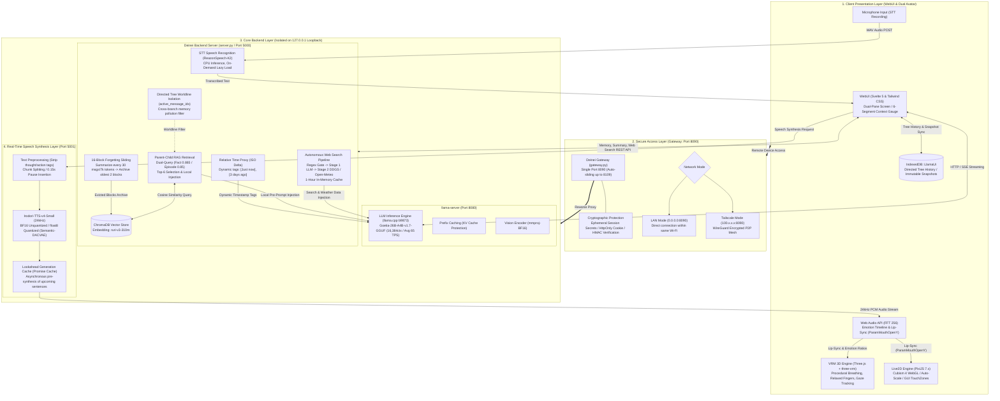

# Deinei

  <a href="README.md">日本語</a> | <b>English</b>

  

    

  

    <b>Local LLM Inference × Long-Term Memory RAG × Live2D / 3D VRM × Real-Time Speech Synthesis</b> 
    Unbroken long-term conversational AI on consumer GPUs (8–24GB VRAM) within a 16,384-token context, 
    powered by forgetting-curve sliding, directed tree worldline isolation, and prefix caching protection.
  

  <!-- Status Badges -->
  

    
    
    
    
    
    
  

  <!-- Specification Navigation (docs/) -->
  

    <a href="docs/external-connections.md"><b>External Network Spec</b></a> •
    <a href="docs/memory-architecture.md"><b>Memory & RAG Spec</b></a> •
    <a href="docs/avatar-and-audio.md"><b>Avatar & Audio Demo</b></a> •
    <a href="docs/web-search-and-weather.md"><b>Web Search & Weather</b></a> •
    <a href="docs/remote-access.md"><b>Remote Access</b></a> •
    <a href="docs/models-and-setup.md"><b>Setup Details</b></a>
  

   

  

---

> [!NOTE]
> **[Transparency & Local-First Privacy Design]**
> All core components of this software—LLM inference, vector database (ChromaDB), Live2D/VRM 3D rendering, and TTS audio synthesis—run entirely locally on your machine.
> External network connections occur only during "initial setup", when the "Web search toggle is ON", and during "on-demand STT model download on first microphone use".
> For explicit domains, port configurations, and network isolation controls, please refer to [docs/external-connections.md](docs/external-connections.md).

---

## [Features] Key Capabilities

| [Long-Term Memory & RAG] Parent-Child Retrieval | [Avatar] Live2D & 3D VRM Dual Engine |
| :--- | :--- |
| • **16-Block Forgetting Sliding**: Compresses every 30 messages into 300–500 token summary blocks. • **Parent-Child Retrieval (ChromaDB)**: Dual-query two-tier search (Fact & Episode) using `ruri-v3-310m`. • **Directed Tree Worldline Isolation**: Branch rewinding and edits prevent memory pollution across parallel branches. • **Dynamic Relative Timestamps**: Injects contextual tags (`[Just now]`, `[3 days ago]`) at inference time. | • **3D VRM Engine (Three.js + three-vrm)**: Procedural breathing, finger relaxation curves, and gaze tracking. • **Live2D Cubism 3/4**: Screen-ratio auto-scaling with GUI touch-zone hitbox editing. • **Intuitive Setup**: Simply drag & drop your `.vrm` file or recommended Live2D ZIP directly onto the screen. • <a href="docs/avatar-and-audio.md#実演デモ動画-なでなでインタラクション表情変化"><b>Demo Video: Headpat interaction & expression changes (MP4)</b></a> |

| [Speech Synthesis] Zero-Shot TTS & Lip-Sync | [Privacy & Access] Local-First & Remote Gateway |
| :--- | :--- |
| • **Irodori-TTS (24kHz)**: High-fidelity zero-shot speech synthesis running entirely on local GPU. • **Asynchronous Lookahead Pipeline**: Pre-synthesizes upcoming text chunks to minimize playback latency. • **Web Audio API Lip-Sync**: FFT frequency analysis for smooth, natural mouth movements (`ParamMouthOpenY`). • **Emotion Timeline Sync**: Transitions avatar facial expressions in real time according to narrative emotion. | • **Local-First & Loopback-Isolated Design**: Core AI processes run strictly on loopback (`127.0.0.1`). • **Isolated Auth Gateway (Port 8090)**: Secure remote access from smartphones and tablets with random tokens. • **Tailscale Mesh Support**: Encrypted P2P remote connection without router port forwarding. • **Smart Autonomous Web Search**: DuckDuckGo / weather forecasts queried dynamically only when toggled ON. • <a href="docs/web-search-and-weather.md#実演デモ動画-自律気象検索リアルタイム天気予報取得"><b>Demo Video: Autonomous weather search & TTS readout (MP4)</b></a> |

---

## [Quick Start] Installation & Launch

> [!CAUTION]
> **[CRITICAL] Always extract the downloaded ZIP archive before running.**
> Running `install.bat` directly from inside the ZIP file without extracting will execute inside Windows Temp and fail.

### Step 1: Download and Extract
1. Download the release package (e.g., `泥濘（Deinei）v0.1.0.zip` or the repository ZIP).
2. Right-click the ZIP file and select **"Extract All..."** to a standard folder.
   - [TIP] We recommend extracting to a short path without spaces or non-ASCII characters (e.g., `C:\deinei` or `D:\deinei`).

### Step 2: Run Automated Setup
1. Double-click **`install.bat`** in the extracted directory.
   - *If Windows SmartScreen appears, click "More info" -> "Run anyway".*
2. A console window will guide you through setting up Python (uv), PyTorch/CUDA, llama.cpp, and TTS models automatically.
3. When prompted: `モデル一式 (約15.3GB) を今すぐ自動ダウンロードしますか？ (y/n)` (Do you want to download model files (~15.3GB) now?), type `y` and press Enter.
4. When `[SUCCESS] Setup Completed!` appears, a shortcut will be created on your desktop.

### Step 3: Launch
1. Launch via the **"Start Deinei" (泥濘 (Deinei) を起動)** desktop shortcut (or run **`start_ai_servers.bat`**).
2. The splash window and desktop GUI launcher will open.
3. Once all services (LLM: 8080, RAG: 5000, TTS: 5001, Gateway: 8090) are initialized, the chat interface opens in your browser automatically.
   - [TIP] To stop all services, click **"Stop All Servers" (全サーバー停止)** on the top right of the launcher window.

---

## [Requirements] System Requirements

| Component | Recommended Specification | Minimum Specification |
| :--- | :--- | :--- |
| **OS** | **Windows 11 (64-bit)** | Windows 10 (64-bit) |
| **CPU** | **AVX2 support, 6 cores / 12 threads or higher** (Intel Core 8th gen+ / AMD Ryzen 3000+) | **x86-64 (SSE4.2), 4 cores or higher** *(SSE4.2 fallback binary automatically selected)* |
| **System RAM** | **32GB or higher** (Allows all processes to reside comfortably in physical RAM) | **16GB** *(~30 TPS verified on 8GB VRAM + 16GB RAM; pagefile space required)* |
| **GPU** | **NVIDIA GeForce RTX 3060 / 4060Ti / 4070 / 4080 / 3090 / 4090 / 50-series** (12GB–32GB VRAM) | **NVIDIA GPU (8GB+ VRAM)** [WARN] **Turing or newer required** (RTX 20 / GTX 16 / RTX 30 / 40 / 50 series) *Pascal (GTX 10 series) is not supported due to CUDA 13 requirements.* |
| **Driver** | **NVIDIA Driver 616.56 or higher** (CUDA 13.3 verified: 616.92) | **NVIDIA Driver 580.xx or higher** (Minimum requirement for CUDA 13.x) |
| **Storage** | **40GB+ free space on SSD** (Model weights ~16GB + Python environments + packages) | **30GB+** *(Actual initial footprint: ~23.5GB)* |
| **Ports** | 5000 (RAG) / 5001 (TTS) / 8080 (LLM) / 8090 (Gateway) | Same as left |

> [!NOTE]
> The installer automatically detects your GPU VRAM (8GB / 12GB / 16GB / 24GB) and generates a tailored configuration (`deining_profile.bat`), tuning MoE CPU offload layers and quantized TTS models accordingly.

---

## [Architecture] System Architecture

Deinei adopts a layered defense-in-depth architecture consisting of four decoupled modules: **Client Presentation Layer**, **Secure Access Layer**, **Core Backend Layer**, and **Real-Time Speech Synthesis Layer**.

---

## [Docs] Documentation Directory

For complete technical specifications, security models, model download instructions, and remote access guides, please see:

| Document | Key Topics |
| :--- | :--- |
| **[External Network Specification](docs/external-connections.md)** | All outbound domains, protocols, triggers, and network blocking controls. |
| **[Memory, RAG & Worldline Isolation](docs/memory-architecture.md)** | 16-block forgetting, parent-child retrieval, relative time proxy, KV cache protection. |
| **[Live2D, 3D VRM & Audio Synthesis](docs/avatar-and-audio.md)** | WebGL rendering, GUI hitboxes, Irodori-TTS lookahead caching, lip-sync, speech recognition. |
| **[Smart Web Search & Weather Forecasts](docs/web-search-and-weather.md)** | 2-stage search pipeline, reverse geocoding, Open-Meteo weather integration. |
| **[Secure Remote Access (LAN / Tailscale)](docs/remote-access.md)** | Gateway architecture, token & cookie authentication, doctor diagnostics. |
| **[Models & Detailed Setup](docs/models-and-setup.md)** | Recommended GGUF models, Vision encoder setup, VRAM profiles, uninstallation. |

---

## [Limitations] Known Limitations

1. **Current Pipeline is Optimized for Japanese**: In v0.1.0, default models (Irodori-TTS, ruri-v3-310m text embedding, ReazonSpeech-K2 STT) and extended documentation (`docs/*.md`) are tailored specifically for Japanese language environments. Native English pipelines and multilingual models are planned in the roadmap.
2. **Speech Recognition (STT) is Experimental**: Voice input via `ReazonSpeech-K2` is experimental and may be sensitive to ambient background noise or microphone levels.
3. **Vision Encoder Enabled by Default Only on 24GB+ GPUs**: Due to VRAM allocation priority, multimodal image recognition (`mmproj`) is enabled by default on 24GB profiles (can be enabled manually on smaller GPUs).
4. **Designed for 16,384 Context Window**: System prompt, memory injection, raw history window, and generation slots are budgeted for 16k tokens.
5. **Autonomous Summarization Requires Open Browser**: Memory consolidation is driven client-side by the active WebUI tab; closing the browser suspends ongoing summarization until reopened.
6. **VRM Gaze is Head-Rotation-Centric**: Eye bone limits depend on the specific VRM model file; gaze tracking is expressed primarily through natural head yaw and pitch.
7. **VRM Idle Animation is Procedural**: Idle stance (relaxed pose + curved fingers + breathing) is computed programmatically via bone measurements rather than static VRMA animations.

---

## [Roadmap] Planned Capabilities

- [ ] **Native English Language Model & TTS Pipeline**: Support switching TTS, STT, and text embedding models to dedicated English OSS models for overseas desktop environments.
- [ ] **Voice Palette & Generator (Reference Voice Re-roll UI)**: Preview and generate reference voice samples with random seeds, and manage custom voice presets easily.
- [ ] **Character Card V2 Spec PNG Import/Export**: Read and create Character Card V2 PNG metadata cards with embedded avatar portraits and personality configurations.
- [ ] **Continuous Upstream llama.cpp Synchronization**: Ongoing tracking of upstream llama.cpp releases for latest quantization schemes and inference speedups.
- [ ] **Speculative Decoding / MTP for Higher TPS**: Utilize Multi-Token Prediction and draft models to dramatically boost tokens-per-second on consumer GPUs.
- [ ] **Laya Lightweight Smart Routing**: Integrate a lightweight intent classifier to decide web search necessity at ultra-low latency without loading heavy LLM steps.

---

## [License] Licenses & Credits

- **Deinei Core**: [MIT License](LICENSE)
- **Third-Party Notices**: [THIRD_PARTY_LICENSES.md](THIRD_PARTY_LICENSES.md)
- **Web Application & UI**: Svelte 5 / Vite / Tailwind CSS (MIT License)
- **Avatar Engine (Live2D)**: PixiJS (MIT License) / pixi-live2d-display (MIT License)
- **Avatar Engine (3D VRM)**: [three.js](https://github.com/mrdoob/three.js) (MIT License) / [@pixiv/three-vrm](https://github.com/pixiv/three-vrm) (MIT License)
- **VRM Specification**: VRM Consortium ([vrm.dev](https://vrm.dev/))
- **Live2D Models**: Usaneko Live2D Model Series by vtem ([Brown Hair](https://vtem.jp/listing/model_0005_favorite/) / [Silver Hair](https://vtem.jp/listing/ulvm2_0001/)) (Free License)
- **Live2D Technology**: Live2D Cubism SDK (Non-commercial license)
- **LLM Inference Engine**: ggml-org llama.cpp b9873 (MIT License)
- **TTS Engine**: Aratako Irodori-TTS-v4-Small / Irodori-TTS-v4-Small-Quantized (MIT License)
- **TTS Audio Codec**: Aratako [Semantic-DACVAE](https://github.com/aratako/Semantic-DACVAE) (MIT License)
- **Text Embedding**: cl-nagoya ruri-v3-310m (Apache 2.0)
- **Vector Database**: ChromaDB (Apache 2.0)
- **Web Search API**: duckduckgo_search (MIT License)
- **Base LLM**: Google DeepMind gemma-4-26B-A4B (Apache 2.0 / Gemma Terms of Use) / Naphula Goetia-26B-A4B-v1.7 (Apache 2.0 / Gemma Terms of Use, GGUF by mradermacher)
- **STT Engine (Experimental)**: Reazon Holdings [ReazonSpeech-K2](https://research.reazon.jp/projects/ReazonSpeech/) (Apache 2.0)
- **Weather Forecast Data**: [Open-Meteo API](https://open-meteo.com/) (CC BY 4.0)
- **Geocoding & Map Data**: [Nominatim](https://nominatim.org/) / © [OpenStreetMap contributors](https://www.openstreetmap.org/copyright) (ODbL)
- **Wikipedia Summary Data**: [Wikimedia REST API](https://en.wikipedia.org/api/rest_v1/) / [Wikipedia](https://ja.wikipedia.org/) ([CC BY-SA 4.0](https://creativecommons.org/licenses/by-sa/4.0/))
