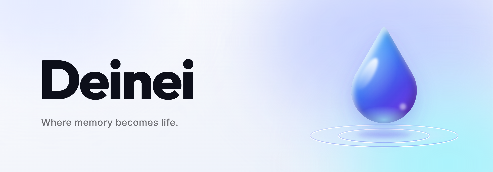
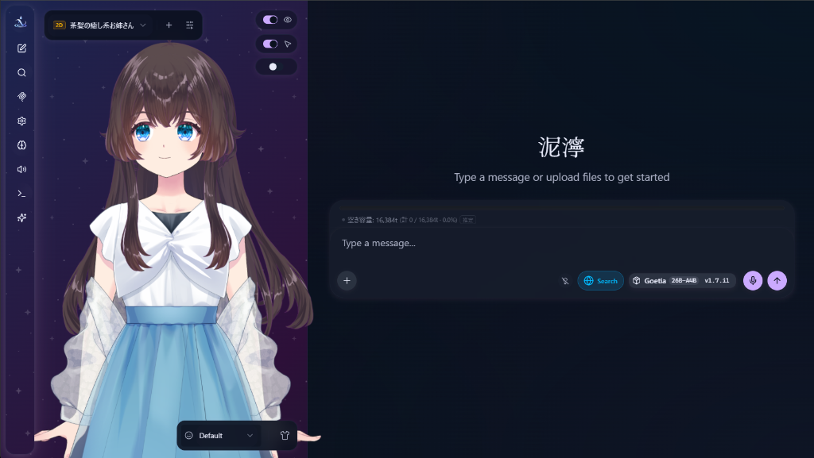
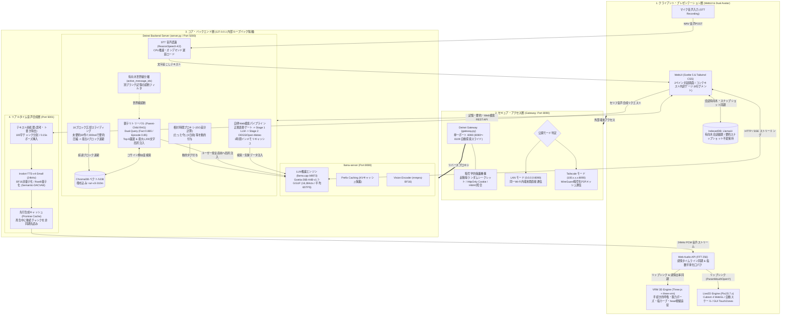

# Deinei / 泥濘

  <b>日本語</b> | <a href="README.en.md">English</a>

  

    

  

    <b>ローカルLLM推論 × 長期記憶RAG × Live2D / VRM 3D × リアルタイム音声合成</b> 
    有限なコンテキストウィンドウ（16,384トークン）内で、忘却制御と有向木世界線分離により 
    破綻のない長期対話と推論速度（KVキャッシュ再利用率）を家庭用GPU（8〜24GB VRAM）で実現。
  

  <!-- ステータスバッジ群 -->
  

    
    
    
    
    
    
  

  <!-- 仕様書ナビゲーション (docs/) -->
  

    <a href="docs/external-connections.md"><b>外部通信仕様</b></a> •
    <a href="docs/memory-architecture.md"><b>記憶・RAG仕様</b></a> •
    <a href="docs/avatar-and-audio.md"><b>アバター＆音声 (実演動画)</b></a> •
    <a href="docs/web-search-and-weather.md"><b>Web検索＆気象 (実演動画)</b></a> •
    <a href="docs/remote-access.md"><b>リモートアクセス</b></a> •
    <a href="docs/models-and-setup.md"><b>セットアップ詳細</b></a>
  

   

  

---

> [!NOTE]
> **【外部通信に関する透明性と仕様】**
> 本ソフトウェアは、LLM推論・長期記憶ベクトルDB（ChromaDB）・Live2D/VRM描画・TTS音声合成のすべてがPCローカル内で完結する設計です。
> 外部インターネットへの接続が発生するのは「初回セットアップ時」「Web検索トグルON時」および「音声認識 (STT) 初回利用時のモデル展開」のみに限定されます。
> 詳細な通信先ドメイン、ポート番号、遮断・制御方法は [docs/external-connections.md](docs/external-connections.md) を参照してください。

---

## [Features] 主な特徴

| [長期記憶・RAG] 親子リトリーバル | [アバター] Live2D ＆ VRM 3D |
| :--- | :--- |
| ・**16ブロック忘却スライディング**: 30件蓄積で約300〜500トークンへ自動圧縮 ・**親子リトリーバル (ChromaDB)**: `ruri-v3-310m` による高精度Fact/Episode二層検索 ・**有向木世界線分離**: ブランチ巻き戻し・編集時も記憶の汚染を防止 ・**相対時間タグ動的付与**: `[たった今]`, `[3日前]` などを推論時に付与 | ・**VRM 3D 描画 (Three.js + three-vrm)**: 自然な呼吸・指の脱力カーブ・視線追従 ・**Live2D Cubism 3/4**: 画面比率に応じた自動スケール＆GUI当たり判定 ・**直感的な配置**: `.vrm` ファイルや推奨ZIPをドラッグ＆ドロップで即座に認識 ・<a href="docs/avatar-and-audio.md#実演デモ動画-なでなでインタラクション表情変化"><b>実演動画: なでなでインタラクション (MP4)</b></a> |

| [音声合成] 高品質TTS ＆ 口パク同期 | [プライバシー] ローカル完結 ＆ セキュア通信 |
| :--- | :--- |
| ・**Irodori-TTS (24kHz)**: ローカル完結の高品質ゼロショット音声合成 ・**先行キャッシュパイプライン**: 非同期処理により発話待機時間を最小化 ・**Web Audio API 口パク連動**: FFT解析による滑らかな口開閉（ParamMouthOpenY） ・**感情タイムライン同期**: セリフの感情変化に合わせて表情がリアルタイム遷移 | ・**限定的な外部通信（ローカル完結設計）**: 推論・記憶・描画・音声はPCローカルで完結（外部通信は明示的な操作時のみに限定、全通信先はdocsに開示） ・**独立認証ゲートウェイ (8090)**: スマホ・タブレットからの安全なリモート操作 ・**Tailscale メッシュ対応**: ルーターのポート開放なしで外出先からP2P直接通信 ・**スマートWeb検索**: トグルON時のみ DuckDuckGo / 気象予報を自律取得 ・<a href="docs/web-search-and-weather.md#実演デモ動画-自律気象検索リアルタイム天気予報取得"><b>実演動画: 自律気象検索＆TTS読み上げ (MP4)</b></a> |

---

## [Quick Start] クイックスタート

> [!CAUTION]
> **【最重要】必ずダウンロードしたZIPファイルを「解凍（すべて展開）」してから実行してください。**
> ZIPファイルを解凍せずに中身の `install.bat` を直接実行すると、Windowsの一時フォルダ（Temp）で動作しエラー終了します。

### ステップ 1: ダウンロードとZIPの解凍
1. 本リポジトリの [ZIPファイル](../../archive/refs/heads/main.zip)（または配布パッケージ「泥濘（Deinei）v0.1.0.zip」）をダウンロードします。
2. ZIPファイルを右クリックし、**「すべて展開...」** を選択して通常のフォルダへ展開します。
   - [TIP] パスに日本語や空白を含まない浅い階層（例: `C:\deinei` や `D:\deinei`）への展開を推奨します。

### ステップ 2: 自動セットアップの実行
1. 展開先フォルダ直下の **`install.bat`** をダブルクリックして実行します。
   - ※Windows SmartScreen（青い警告画面）が表示された場合は、「詳細情報」→「実行」をクリックしてください。
2. コマンドプロンプトが立ち上がり、Python仮想環境構築、PyTorch/CUDA導入、llama.cpp、TTSモデル等のセットアップが自動進行します。
3. 終盤で「モデル一式 (約15.3GB) を今すぐ自動ダウンロードしますか？ (y/n)」と表示されたら、`y` を入力して Enter を押します。
4. `[SUCCESS] Setup Completed!` と表示されたら導入完了です。デスクトップにショートカットが作成されます。

### ステップ 3: 起動（統合GUIランチャー）
1. デスクトップの **「泥濘 (Deinei) を起動」** ショートカット（またはフォルダ直下の **`start_ai_servers.bat`**）を実行します。
2. ブラウザでスプラッシュ画面が開き、デスクトップ上に統合ランチャー画面が立ち上がります。
3. 全サーバー（LLM: 8080, RAG: 5000, TTS: 5001, Gateway: 8090）の起動が完了すると、自動的に対話画面へ遷移します。
   - [TIP] 終了時はランチャー画面右上の「全サーバー停止」を押すことで、全プロセスが一括終了しリソースが解放されます。

---

## [Requirements] 動作要件

| 項目 | 推奨環境 | 最低動作環境 |
| :--- | :--- | :--- |
| **OS** | **Windows 11 (64-bit)** | Windows 10 (64-bit) ※MS公式サポート終了済み |
| **CPU** | **AVX2 命令セット対応 6コア/12スレッド以上** (Intel 第8世代 Core / AMD Ryzen 3000番台以降) | **x86-64 (SSE4.2) 4コア以上** ※SSE4.2/x64バックエンドを同梱し実行時に自動選択 |
| **システムRAM** | **32GB 以上** (全プロセスを物理RAM内に余裕で常駐可能) | **16GB** (VRAM 8GB + RAM 16GB環境にて 実測約30 TPS を確認済み ※SSDの空き容量・ページファイル確保が必要) |
| **GPU** | **NVIDIA GeForce RTX 3060・5070 (12GB) / 4060Ti・5060Ti・5070Ti・5080 (16GB) / 3090・4090 (24GB) / 5090 (32GB)** (VRAM 12GB〜32GB) | **NVIDIA GPU (VRAM 8GB以上)** [WARN] **Turing世代以降必須** (RTX 20系 / GTX 16系以降 / RTX 50系) ※Pascal (GTX 10系) 以前はCUDA 13非対応のため動作対象外 |
| **GPUドライバ** | **NVIDIA Driver 616.56 以上** (CUDA 13.3対応。実機確認: 616.92) | **NVIDIA Driver 580.xx 以上** (CUDA 13.x の最小要件) |
| **ストレージ** | **SSD 40GB 以上の空き容量** (モデル約16GB＋Python環境＋依存パッケージ＋一時ファイル) | **30GB 以上** ※実測: 23.5GB（TTS用venv 5.0GBを含む構成） |
| **空きポート** | 5000 (RAG) / 5001 (TTS) / 8080 (LLM) / 8090 (Gateway) | 同左 |

> [!NOTE]
> お使いのGPUのVRAM容量（8GB / 12GB / 16GB / 24GB）をインストーラーが自動判別し、MoE CPUオフロード数や量子化TTSモデル等の最適プロファイル（`deining_profile.bat`）を自動生成します。

---

## [Architecture] システムアーキテクチャ

泥濘 (Deinei) は、**「クライアント・プレゼンテーション層」「セキュア・アクセス層」「コア・バックエンド層」「リアルタイム音声合成層」** の 4 つの独立したモジュールが協調し、家庭用GPU環境においてコンテキスト長 16,384 トークンを最大限に活用しながら、破綻のない長期記憶と超高速な推論・発話レスポンスを実現する多層防御・最適化アーキテクチャを採用しています。

### 各レイヤーの技術設計とデータフロー

- **1. プレゼンテーション層 (WebUI & Dual Avatar)**:
  - **有向木会話ステート (Tree State)**: 会話履歴を有向木構造として IndexedDB（`LlamaUi`）に保持。不変スナップショットと `reconcileSummarySnapshot` により、ブランチ切り替えや過去発言の編集・巻き戻し時にも要約文脈を復元。
  - **デュアルアバターレンダリング**: VRM 3D（自然な呼吸・指の脱力カーブ・head主体の視線追従を手続き的実装で描画）と Live2D（Cubism 3/4 WebGL・自動スケール・GUI当たり判定 TouchZones）の両方に対応。
  - **コンテキスト可視化ゲージ**: 6セグメント（System / Summary / History / Memory / Search / Reserved）のスタックバーにより、16,384 トークンの使用状況をミリ秒単位で可視化。
- **2. セキュア・アクセス層 (Gateway: 8090)**:
  - **ローカル隔離**: LLM (8080), Backend (5000), TTS (5001) を `127.0.0.1` に厳格バインドし、外部ネットワークに露出させない設計。
  - **独立認証ゲートウェイ**: 単一ポート 8090（競合時は 8090〜8109 を自動探索スライド）でのみ外部待受。起動毎ランダムシークレットトークンと Cookie、HMAC-SHA256 タイミング攻撃防止。
  - **接続モード**: 同一Wi-Fi内直接通信の「LAN モード」と、WireGuard P2P暗号化メッシュによる「Tailscale モード」の2系統をサポート。
- **3. コア・バックエンド層 (推論・記憶・検索)**:
  - **16ブロック忘却スライディング**: 未要約30件または7,000トークン到達時に要約ブロック（300〜500トークン）へ自動圧縮。最大16ブロックを保持し、超過した最古2ブロックをChromaDBへ自動アーカイブ。
  - **Dual-Query親子検索 (Parent-Child RAG)**: Fact記憶（距離 <= 0.135）とEpisode記憶（距離 <= 0.150）を独立検索し、統合Top-6を厳選。親データ（最大600文字/件）を想起上限最大3件・計約1,200文字で厳格トリム。
  - **有向木世界線分離**: 選択中ブランチの祖先ノードID群（`active_message_ids`）のみでフィルタリングし、別世界線の記憶混入を遮断。
  - **Prefix Caching保護の局所注入**: 想起記憶および相対時間タグ（`[たった今]`, `[3日前]` 等）を過去ログではなく「ユーザー発言直前」へ注入することで、過去ログ領域のKVキャッシュを保護。
  - **自律Web検索 ＆ 気象予報**: 正規表現ゲートで日常会話の推論負荷を遮断。Stage 1 LLMで指示語解決、Stage 2 で DuckDuckGo/Open-Meteo取得、1時間インメモリキャッシュ。
  - **音声認識 (STT)**: VRAMを消費しないCPU推論（`ReazonSpeech-K2`）を採用したオンデマンド遅延ロード。
- **4. リアルタイム音声合成層 (Irodori-TTS: 5001)**:
  - **高品質ゼロショット音声合成**: 24kHz（Semantic-DACVAE）。24GB環境はBF16非量子化、16GB以下はfloat8量子化。
  - **セリフ前処理 ＆ 非同期先行キャッシュ**: 思考タグ `<think>`・ト書き・マークダウンを自動ストリップ。文節再生中に後続チャンクを非同期パイプライン（Promise）で先行合成・キャッシュし待機時間を最小化。
  - **Web Audio API 口パク ＆ 感情同期**: 音声をリアルタイムFFT解析し滑らかな口開閉（`ParamMouthOpenY`）を実現。テキスト内の感情語比率と音声再生進捗をリアルタイム同期。

---

## [Docs] ドキュメント一覧

各機能の技術仕様、通信設計、モデル手動配置、詳細設定については以下の個別仕様書を参照してください：

| 仕様書 | 主な内容 |
| :--- | :--- |
| **[外部通信一覧仕様書](docs/external-connections.md)** | 全外部通信先ドメイン、プロトコル、トリガー条件、遮断・制御方法 |
| **[長期記憶・RAG・世界線分離仕様書](docs/memory-architecture.md)** | 16ブロック忘却、親子リトリーバル、相対時間プロキシ、世界線分離、KVキャッシュ挙動 |
| **[Live2Dアバター・音声合成・音声認識仕様書](docs/avatar-and-audio.md)** | Live2D WebGL描画、GUIおさわり判定、Irodori-TTS先読み・口パク同期、音声認識 (STT) |
| **[スマートWeb検索・気象予報仕様書](docs/web-search-and-weather.md)** | 2段階自律検索パイプライン、地名逆引き、Open-Meteo気象連携、KVキャッシュ保護 |
| **[セキュア・リモートアクセス仕様書 (LAN / Tailscale)](docs/remote-access.md)** | 独立認証ゲートウェイ（8090）、トークン・Cookie保護、LAN/Tailscale接続手順、Doctor診断 |
| **[モデル準備・詳細設定・アンインストール仕様書](docs/models-and-setup.md)** | 推奨モデル・Vision・Live2Dの手動配置先、ハードウェア別プロファイル、アンインストール手順 |

---

## [Limitations] 既知の制限

1. **音声認識 (STT) は試験的機能**: `ReazonSpeech-K2` による音声入力は現在試験的な提供にとどまります。周囲のノイズやマイク音量によって誤認識が発生する場合があります。
2. **Vision エンコーダの既定有効は 24GB 級のみ**: 画像認識エンコーダ（`mmproj`）はVRAM消費と速度の観点から、既定では 24GB プロファイルでのみ有効化されます（22GB未満環境でも手動有効化可能）。
3. **コンテキスト長は 16,384 トークン設計**: 16ブロック忘却機構と生ログ枠・生成枠を考慮した配分で設計されています。
4. **自律要約はブラウザを開いている間のみ進行**: 対話の要約圧縮や長期記憶の抽出はフロントエンド主導で処理されるため、ブラウザを閉じている間は進行しません。
5. **VRM の視線は head 回転主体で、目ボーンの可動域はモデル依存**: 視線追従は主に head 回転（yaw: 最大約20度、pitch: 最大約10度）で表現されます。目ボーンの可動範囲はモデル依存です。
6. **VRM 待機モーションは手続き的生成（VRMA 不使用）**: 待機ポーズ（脱力ポーズ + 指のリラックスカーブ + 呼吸）はロード時に bone 計測で符号を決める手続き的実装です。

---

## [Roadmap] 今後の開発計画

泥濘 (Deinei) では、ローカル環境における対話体験と拡張性をさらに向上させるため、以下の機能実装を計画しています：

- [ ] **英語環境へのネイティブ対応 (OSS パイプライン多言語化)**: 音声合成 (TTS)、音声認識 (STT)、テキスト埋め込み (Embedding) などの各種モデルを英語向け OSS へ切り替え可能にし、英語圏でのローカル運用に対応。
- [ ] **TTS ボイスモデル・ガチャ (リファレンスボイス再生成 UI)**: リファレンス音声をランダムまたはシード指定で再生成・プレビューし、気に入った声質を直感的に保存・切り替えできる UI の提供。
- [ ] **Character Card V2 Spec による PNG キャラクターのインポート / 作成**: AI キャラクター対話規格（Character Card V2）に準拠した PNG 画像メタデータの読み込み、および新規カード作成・編集・エクスポート機能。
- [ ] **最新 llama.cpp アップストリームへの追従**: 最新ビルドへの継続的なアップデートにより、推論効率の最適化および最新機能・量子化形式を迅速に取り込み。
- [ ] **MTP (Multi-Token Prediction / 投機的サンプリング) による TPS 向上**: MTP や Speculative Decoding を活用し、家庭用 GPU におけるトークン生成速度（Tokens Per Second）を飛躍的に向上させ、より即応性の高いリアルタイム対話を実現。
- [ ] **Laya によるスマート検索トリガー判定**: 軽量な意図分類・ルーター機構（Laya）を導入し、推論負荷を最小限に抑えながらユーザー入力に対する自律Web検索・気象情報の要否を超高速・高精度に判定。

---

## [License] ライセンス ＆ クレジット

- **泥濘 (Deinei) 本体**: [MIT License](LICENSE)
- **サードパーティ製ライセンス・権利表記**: [THIRD_PARTY_LICENSES.md](THIRD_PARTY_LICENSES.md)
- **UI & Web Application**: Svelte 5 / Vite / Tailwind CSS (MIT License)
- **Avatar Engine (Live2D)**: PixiJS (MIT License) / pixi-live2d-display (MIT License)
- **Avatar Engine (VRM 3D)**: [three.js](https://github.com/mrdoob/three.js) (MIT License) / [@pixiv/three-vrm](https://github.com/pixiv/three-vrm) (MIT License)
- **VRM Specification**: VRM Consortium ([vrm.dev](https://vrm.dev/))
- **Live2D Models**: Usaneko式 Live2Dモデル by vtem ([茶髪の癒し系お姉さん](https://vtem.jp/listing/model_0005_favorite/) / [銀髪の女の子](https://vtem.jp/listing/ulvm2_0001/)) (Free License)
- **Live2D Technology**: Live2D Cubism SDK (非収益型コンテンツ向けプラン)
- **LLM Inference Engine**: ggml-org llama.cpp b9873 (MIT License)
- **TTS Engine**: Aratako Irodori-TTS-v4-Small / Irodori-TTS-v4-Small-Quantized (MIT License)
- **TTS Audio Codec**: Aratako [Semantic-DACVAE](https://github.com/aratako/Semantic-DACVAE) (MIT License)
- **Text Embedding**: cl-nagoya ruri-v3-310m (Apache 2.0)
- **Vector Database**: ChromaDB (Apache 2.0)
- **Web Search API**: duckduckgo_search (MIT License)
- **Base LLM**: Google DeepMind gemma-4-26B-A4B (Apache 2.0 / Gemma Terms of Use) / Naphula Goetia-26B-A4B-v1.7 (Apache 2.0 / Gemma Terms of Use, 量子化提供: mradermacher)
- **STT Engine (Experimental)**: Reazon Holdings [ReazonSpeech-K2](https://research.reazon.jp/projects/ReazonSpeech/) (Apache 2.0)
- **Weather Forecast Data**: [Open-Meteo API](https://open-meteo.com/) (CC BY 4.0)
- **Geocoding & Map Data**: [Nominatim](https://nominatim.org/) / © [OpenStreetMap contributors](https://www.openstreetmap.org/copyright) (ODbL)
- **Wikipedia Summary Data**: [Wikimedia REST API](https://en.wikipedia.org/api/rest_v1/) / [Wikipedia](https://ja.wikipedia.org/) ([CC BY-SA 4.0](https://creativecommons.org/licenses/by-sa/4.0/))
